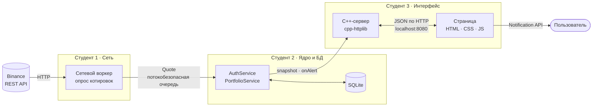
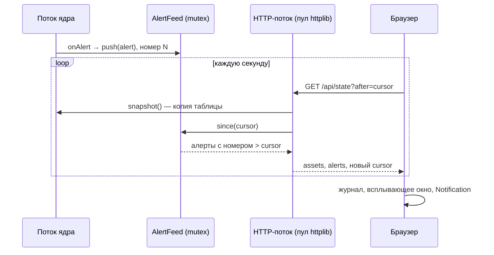

# Архитектура Price Alert

Документ описывает устройство проекта и порядок запуска. Описание продукта и функционала — в [ОПИСАНИЕ.md](ОПИСАНИЕ.md).

## Содержание
1. [Запуск](#1-запуск)
2. [Общая схема](#2-общая-схема)
3. [Модули и роли](#3-модули-и-роли)
4. [Контракт ядра](#4-контракт-ядра-core_api)
5. [Интерфейс: сервер и страница](#5-интерфейс-сервер-и-страница)
6. [Потоки и синхронизация](#6-потоки-и-синхронизация)
7. [HTTP API](#7-http-api)
8. [Структура репозитория](#8-структура-репозитория)
9. [Подключение настоящего ядра](#9-подключение-настоящего-ядра)
10. [Решение проблем](#10-решение-проблем)

---

## 1. Запуск

### Быстрый старт (Windows 10/11)
```bat
git clone https://github.com/VsevolodYakushev/price-alert.git
cd price-alert
run.bat
```

Что делает `run.bat`:
1. Если `PriceAlert.exe` ещё нет, вызывает `build.bat`.
2. `build.bat` ищет компилятор в таком порядке:
   - `g++` в `PATH`;
   - портативный [w64devkit](https://github.com/skeeto/w64devkit) в папке `tools\`;
   - если его нет, **сам скачивает** w64devkit 2.10.1 (около 65 МБ, один раз) в `tools\` и распаковывает.
   Устанавливать Qt, Visual Studio или CMake не нужно.
3. Сборка занимает около 25 секунд. Получается один статический `PriceAlert.exe` размером около 3,6 МБ.
4. Сервер запускается на `http://localhost:8080` и сам открывает браузер.

Демо-вход: **`demo` / `demo123`**, код подтверждения **`123456`**. В демо-портфеле уже есть 7 тикеров. Цели стоят рядом с ценой, поэтому алерты начинают приходить в первые секунды.

### Пересборка
| Что изменилось | Что сделать |
|---|---|
| C++-код (`web/*.cpp`, `web/*.h`, `mock/`, `core_api/`) | Закрыть окно сервера, запустить `build.bat`, затем `run.bat` |
| Страница (`web/static/*`) | Обновить вкладку браузера (F5), пересборка не нужна |

### Параметры запуска
```bat
PriceAlert.exe [порт] [--no-browser]
PriceAlert.exe 8091 --no-browser   :: вторая копия на другом порту, без открытия браузера
```
Сервер слушает только `127.0.0.1`, из сети он недоступен. Сервер ищет страницу в `web\static` относительно текущей папки. Поэтому запускайте его из корня репозитория (`run.bat` переходит туда сам).

### Сборка вручную (любой GCC/Clang с C++17)
```bash
g++ -std=c++17 -O2 -D_WIN32_WINNT=0x0A00 -I. \
    web/server.cpp mock/MockAuthService.cpp mock/MockPortfolioService.cpp \
    -o PriceAlert.exe -static -lws2_32 -lshell32
```

---

## 2. Общая схема



Модули связаны **только через интерфейсы** из `core_api/`. Пока сеть и ядро в разработке, вместо них работает **мок-ядро** (`mock/`) с теми же интерфейсами: оно случайно двигает цены и само генерирует алерты. Интерфейс полностью работает уже сейчас.

---

## 3. Модули и роли

| Модуль | Участник | Ответственность | Где в коде |
|---|---|---|---|
| Сеть | Студент 1 | Опрос Binance по тикерам из `symbols()`, очередь `Quote` (push, pop с таймаутом, close), учёт лимитов запросов | будет добавлен |
| Ядро и БД | Студент 2 | Пользователи и портфели в SQLite, проверка целей, генерация алертов, реализация `AuthService` и `PortfolioService` | будет добавлен, пока работает `mock/` |
| Интерфейс | Студент 3 | HTTP-сервер, JSON-API, страница, история цен для графика, доставка алертов в браузер | `web/` |

Структура котировки, которую сеть передаёт ядру:
```cpp
struct Quote { std::string symbol; double price; std::chrono::system_clock::time_point ts; };
```

---

## 4. Контракт ядра (`core_api/`)

Общие структуры (`core_api/Types.h`):

| Структура | Поля |
|---|---|
| `User` | `id`, `username`, `email` |
| `AssetConfig` | `id`, `symbol` (`BTCUSDT`), `target_price`, `enabled` |
| `AssetSnapshot` | `asset`, `last_price` (может отсутствовать), `ts` |
| `Alert` | `symbol`, `price`, `threshold`, `ts` |
| `AuthResult` | `Ok`, `NeedCode`, `BadCredentials`, `UserExists`, `BadCode`, `InvalidInput`, `Error` |

`AuthService` (`core_api/AuthService.h`):
```cpp
AuthResult registerUser(username, email, password);
AuthResult login(username, password);           // NeedCode → нужен код из письма
AuthResult verifyCode(username, code);
void logout();
std::optional<User> currentUser() const;
```

`PortfolioService` (`core_api/PortfolioService.h`):
```cpp
std::optional<int64_t> addAsset(symbol, target_price);  // nullopt — дубль или неизвестный тикер
void removeAsset(int64_t id);
void setThreshold(int64_t id, double price);
std::vector<AssetSnapshot> snapshot() const;            // копия, можно звать из любого потока
void onAlert(std::function<void(const Alert&)> cb);     // cb вызывается из потока ядра
```

Правила контракта:
- Методы вызываются по одному, как из одного UI-потока.
- `snapshot()` безопасно вызывать из любого потока: он возвращает копию.
- Колбэк `onAlert` приходит **из потока ядра**. UI сам переносит алерт к себе.
- `onAlert(nullptr)` отписывает. После возврата из него старый колбэк больше не вызывается.
- Тексты ошибок пишет UI, ядро возвращает только `AuthResult`.
- Алерт срабатывает один раз, когда цена опускается до цели. Повторно — только после того, как цена вернётся выше цели.

> Тип `id`, возвращаемое значение `addAsset` и полный список `AuthResult` — допущения UI. Их нужно сверить с реализацией Студента 2.

---

## 5. Интерфейс: сервер и страница

| Файл | Назначение |
|---|---|
| `web/server.cpp` | Точка входа: создаёт сервисы, регистрирует маршруты API, раздаёт `web/static`, открывает браузер |
| `web/AlertFeed.h` | Потокобезопасная лента алертов с возрастающими номерами |
| `web/PriceHistory.h` | Фоновый поток, который раз в секунду снимает `snapshot()` и хранит до 300 точек на актив для графика |
| `web/Json.h` | Сборка JSON-ответов без внешних библиотек |
| `web/static/index.html` | Разметка: вход, регистрация, код, дашборд |
| `web/static/app.css` | Тёмная тема, цвета заданы переменными в `:root` |
| `web/static/app.js` | Логика страницы: формы, опрос сервера, таблица, график на `<canvas>`, уведомления |
| `third_party/httplib.h` | [cpp-httplib](https://github.com/yhirose/cpp-httplib) v0.59.0, один заголовочный файл, лицензия MIT |

Страница раз в секунду запрашивает `/api/state`. В ответе — таблица и новые алерты. При выборе актива страница один раз подгружает его историю через `/api/history`, дальше дополняет её сама. Строки таблицы обновляются точечно: если открыт редактор цели, ячейка не перерисовывается.

---

## 6. Потоки и синхронизация



| Поток | Кто создаёт | Что делает |
|---|---|---|
| Главный | `main()` | Запуск сервера, ожидание завершения |
| Пул HTTP | cpp-httplib | Обработка запросов браузера |
| Поток ядра | `MockPortfolioService` (потом реальное ядро) | Тик цен раз в 500 мс, проверка целей, вызов `onAlert` |
| Поток истории | `PriceHistory` | Снимок `snapshot()` раз в секунду для графика |

Как устроена синхронизация:
- **`uiMutex` в `server.cpp`.** Запросы приходят из разных потоков пула, а ядро ждёт вызовов из одного «UI-потока». Поэтому все вызовы сервисов, кроме `snapshot()`, идут под одним мьютексом, по очереди.
- **`AlertFeed`.** Колбэк ядра только кладёт алерт под `std::mutex` и сразу возвращается, поэтому поток ядра не ждёт сеть. У каждого алерта есть номер. Браузер запрашивает только алерты новее своего курсора, поэтому алерт не теряется и не приходит дважды. Без параметра `after` сервер возвращает только текущий курсор, и после входа старые алерты не показываются.
- **`std::condition_variable`.** Фоновые потоки ждут через `wait_for` и мгновенно просыпаются при остановке, не нагружая процессор.
- **Порядок уничтожения** в `main()`. `AlertFeed` объявлена первой, поэтому уничтожается последней: поток ядра может писать в неё до конца. `PriceHistory` объявлена после `portfolio`, поэтому её поток останавливается раньше ядра. Перед выходом вызывается `onAlert(nullptr)`.

---

## 7. HTTP API

Параметры передаются как `application/x-www-form-urlencoded` (в query или в теле POST). Ответы — JSON. Все методы, кроме входа и регистрации, без активной сессии возвращают `401`.

| Метод | Путь | Параметры | Ответ |
|---|---|---|---|
| GET | `/api/me` | — | `{user}` (`null`, если не вошли) |
| POST | `/api/register` | `username`, `email`, `password` | `{result, user}` |
| POST | `/api/login` | `username`, `password` | `{result, user}` |
| POST | `/api/verify` | `username`, `code` | `{result, user}` |
| POST | `/api/logout` | — | `{result}` |
| GET | `/api/state` | `after` (необязательно) | `{assets[], alerts[], cursor}` |
| GET | `/api/history` | `id` | `{points: [[мс, цена], …]}` |
| POST | `/api/assets` | `symbol`, `target` | `{id}`, или `409`, если тикер отклонён |
| POST | `/api/assets/remove` | `id` | `{result}` |
| POST | `/api/assets/threshold` | `id`, `target` | `{result}` |

Пример актива в `assets[]`:
```json
{"id":1,"symbol":"BTCUSDT","target":67850,"enabled":true,"price":68214.37,"ts":1793803927723}
```

---

## 8. Структура репозитория

```
price-alert/
├── run.bat                 запуск: сборка при необходимости, сервер, браузер
├── build.bat               сборка (сам находит или скачивает компилятор)
├── ARCHITECTURE.md         этот документ
├── ОПИСАНИЕ.md             описание продукта и функционала
├── core_api/               контракт ядра: Types.h, AuthService.h, PortfolioService.h
├── mock/                   мок-ядро: демо-пользователь, случайные цены, алерты
├── web/
│   ├── server.cpp          HTTP-сервер и маршруты API
│   ├── AlertFeed.h         лента алертов
│   ├── PriceHistory.h      история цен для графика
│   ├── Json.h              сборка JSON
│   └── static/             index.html, app.css, app.js
├── third_party/httplib.h   cpp-httplib (MIT)
└── qt-version/             ранний вариант UI на Qt 6 (архив, не собирался)
```

---

## 9. Подключение настоящего ядра

1. Реализовать `AuthService` и `PortfolioService` из `core_api/` (Студент 2) и подключить к ядру очередь `Quote` от сетевого модуля (Студент 1).
2. В `web/server.cpp` заменить `MockAuthService` и `MockPortfolioService` на реальные классы и убрать вызов `seedDemoData()`.
3. Добавить новые `.cpp` в команду компиляции в `build.bat`. Для SQLite проще всего положить amalgamation (`sqlite3.c`, `sqlite3.h`) в `third_party/` и тоже добавить в сборку.

Код страницы и сервера при этом менять не нужно.

---

## 10. Решение проблем

| Симптом | Причина и решение |
|---|---|
| Окно `run.bat` сразу закрывается | Запустите его из `cmd`, чтобы увидеть ошибку. Скрипт сам останавливается на ошибке и ждёт нажатия клавиши |
| «Сервер недоступен» / «Страница открыта как файл» | Открыт `index.html` двойным щелчком. Нужно запускать `run.bat` и открывать `http://localhost:8080` |
| «Порт 8080 занят» | Сервер уже запущен (откройте ссылку) или порт занят другой программой: `PriceAlert.exe 8091` |
| «Неверное имя пользователя или пароль» | Пароль демо — `demo123`, а `123456` — это код подтверждения на следующем шаге |
| `build.bat` не может скачать компилятор | Скачайте [w64devkit-x64-2.10.1.7z.exe](https://github.com/skeeto/w64devkit/releases/tag/v2.10.1) вручную в `tools\download\w64devkit.7z.exe` и снова запустите `build.bat` |
| После правки C++ ничего не изменилось | `run.bat` собирает проект, только если exe нет. Запустите `build.bat` (перед этим закройте окно сервера) |
| Нет системных уведомлений | Разрешите уведомления для `localhost` в браузере. Всплывающее окно на странице и журнал работают и без этого |
